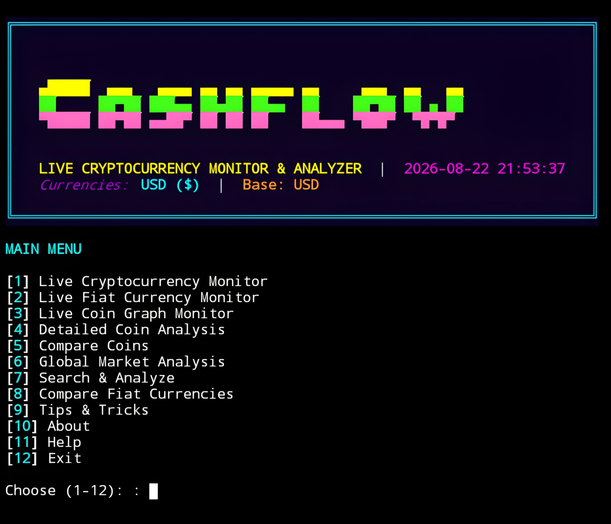

# CASHFLOW


<p align="center">
  <strong>Cryptocurrency Live Monitor & Analyzer – Cyberpunk Neon Edition</strong><br>
  <em>"Real-time market intelligence, wrapped in neon." – Mr.X</em>
</p>

## Introduction
CASHFLOW is a powerful terminal-based cryptocurrency monitoring and analysis tool. With a sleek cyberpunk neon interface, it provides real-time price data, market insights, fiat currency rates, and a suite of analytical tools—all in one place. Built with Python and the Rich library, CASHFLOW runs smoothly on **Termux (Android)**, Linux, Windows, and Kali Linux—**no root required**. Data is powered by **CoinGecko API** and **Open Exchange Rates**.

## Installation
```bash
$ pkg update -y && pkg upgrade -y
$ pkg install git python -y
$ git clone https://github.com/Whomrx666/cashflow.git
$ cd cashflow
$ python3 cashflow.py
$ python3 install.py
```

## Run manually
```
$ python3 cashflow.py
```

## Features
- **Live Cryptocurrency Monitor** – Multi-currency prices, market cap, volume, sparklines.
- **Live Fiat Currency Rates** – Track exchange rates for 40+ fiat currencies.
- **Coin Graph Monitor** – Visual ASCII graphs for selected coins.
- **Detailed Coin Analysis** – In-depth metrics: ATH, ATL, supply, description, categories.
- **Compare Coins** – Side-by-side comparison of multiple cryptocurrencies.
- **Global Market Analysis** – Total market cap, volume, dominance, top gainers/losers.
- **Search & Analyze** – Search for any coin and instantly view details.
- **Fiat Currency Converter** – Convert between fiat currencies with live rates.
- **Tips & Tricks** – Curated tips for security, trading, investing, and mining.
- **Command-line Arguments** – Customize coins, currencies, refresh interval, and more.
- **Cyberpunk UI** – Neon colors, live tables, progress bars, and smooth animations.
- **Termux Optimized** – Works flawlessly on Android without root.

## Menu Options
| #  | Option | Description |
|----|--------|-------------|
| 1  | Live Cryptocurrency Monitor | Real-time coin prices, market cap, volume, sparklines |
| 2  | Live Fiat Currency Monitor | Exchange rates for major fiat currencies |
| 3  | Live Coin Graph Monitor | ASCII graph for selected coins (BTC, ETH, etc.) |
| 4  | Detailed Coin Analysis | Deep dive into a specific coin's metrics |
| 5  | Compare Coins | Compare multiple coins side by side |
| 6  | Global Market Analysis | Total market cap, volume, top gainers/losers |
| 7  | Search & Analyze | Search any coin and view details |
| 8  | Compare Fiat Currencies | Convert between fiat currencies |
| 9  | Tips & Tricks | Security, trading, investing, mining tips |
| 10 | About | Information about the program |
| 11 | Help | Usage guide and command-line arguments |
| 12 | Exit | Quit the program |

## Instructions
1. **Install** the tool using the commands above.
2. **Run** `python3 cashflow.py` after installation.
3. **Navigate** the main menu by typing the option number and pressing Enter.
4. **In live monitors**:
   - `Enter` / `n`  next page
   - `p`  previous page
   - `q`  return to menu
   - `x`  exit program
   - `Ctrl+C`  interrupt and return
5. **Command-line mode** (optional):  
   ```bash
   python3 cashflow.py --coins bitcoin,ethereum --currencies usd,idr --interval 15
   ```
   See `python3 cashflow.py --help` for all arguments.

## Observation
This tool is intended for **educational and informational purposes only**. Cryptocurrency markets are highly volatile; nothing in this application constitutes financial advice. Always do your own research before making investment decisions. The author assumes no responsibility for any financial loss or misuse of the data provided.

### Original Author
<a href="https://github.com/Whomrx666"></a>

### <<< If you copy, then give me the credits >>>

## CONNECT WITH ME :

[](https://whomrx.pages.dev) <br>
[](https://whomrxhackers.blogspot.com) <br>
[](https://twitter.com/whomrx666) <br>
[](https://wa.me/6285926601133?text=Halo%2C%20Mr.X) <br>
[](https://www.facebook.com/whomrx.666) <br>
[](https://t.me/Whomr_X) <br>
[](mailto:whomrx666@gmail.com) <br>
[](https://www.tiktok.com/@whomr.x)

**If you want to donate, click on the button**
<a href="https://saweria.co/whomrx"></a>

---

<p align="left">
  
</p>